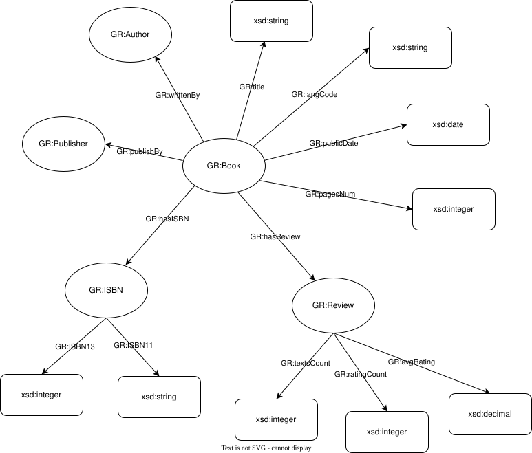
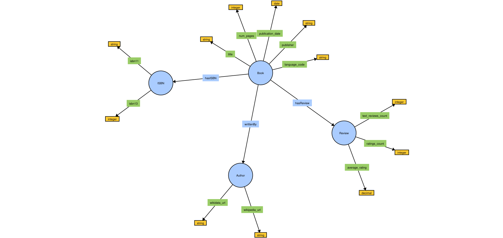

# Goodreads Book Review

The project transforms the goodreads book review in CSV format into TTL using Jupyter Notebook and SPARQL.

First we created the ontology with the data in the CSV file.



Secondly, we fixed the malformed row in the CSV data because there are some rows that have extra comma, meaning it cannot read the format properly, so we had to fix the format. 

```python
# Fix malformed row

import tempfile
import csv
import shutil

def fix_row(row):
    return [f'"{field}"' if ',' in field and not (field.startswith('"') and field.endswith('"')) else field for field in row]

path = "../data"
path_clean = "../data/clean"

files = [re.sub(r".csv", "", f) for f in listdir(path) if isfile(join(path, f))]

for file in files:
    full_path = f"{path}/{file}.csv"
    if not exists(full_path):
        print(f"File not found: {full_path}")

    with open(full_path, "r", encoding="utf-8") as f:
        reader = csv.reader(f)
        lines = list(reader)

    header = lines[0]
    fixed_rows = [header]

    for i, row in enumerate(lines[1:], start=2):  # start=2 to match line numbers (1-based with header)
        if len(row) != 12:
            # Try to auto-fix by quoting comma-containing fields
            row = fix_row(row)
        if len(row) == 12:
            fixed_rows.append(row)
        else:
            print(f"Skipping malformed line {i} in {file}: {row}")

    # Save to a temporary cleaned file

    with tempfile.NamedTemporaryFile(mode="w+", newline='', delete=False, suffix=".csv") as tmp:
        writer = csv.writer(tmp)
        writer.writerows(fixed_rows)
        tmp_path = tmp.name

    # Save permanently with the same name as original
    cleaned_path = join(path_clean, f"{file}.csv")
    shutil.copy(tmp_path, cleaned_path)
    print(f"Saved cleaned file: {path_clean}")
```
        
Next, we added an extra function to search the author of the book on wikipedia. The output will be saved to authors.csv. 

```python
# Search Author wiki link

import requests
import time
import json

with open("occu.json", "r", encoding="utf-8") as f:
    occu_data = json.load(f)

occupations = list(occu_data["occu"].keys())
organizations = list(occu_data["orga"].keys())

occ_str = ",".join([f"wd:{qid}" for qid in occupations])
org_str = ",".join([f"wd:{qid}" for qid in organizations])
unmatched_entities = [] 

# Load the dataset
books = pd.read_csv(f"{path_clean}/books.csv")

# Normalize author names: collapse multiple spaces into one
def clean_author(author):
    return re.sub(r'\s+', ' ', author.strip())

books["authors"] = books["authors"].astype(str).apply(clean_author)

# Extract unique author names
unique_authors = set()
for author_list in books["authors"]:
    for author in author_list.split("/"):
        unique_authors.add(clean_author(author))

# Extract Wikipedia URL from Wikidata entity
def get_wikipedia_from_entity(entity_id):
    try:
        url = f"https://www.wikidata.org/wiki/Special:EntityData/{entity_id}.json"
        response = requests.get(url, timeout=20)
        entity_data = response.json()
        sitelinks = entity_data["entities"][entity_id]["sitelinks"]
        if "enwiki" in sitelinks:
            return sitelinks["enwiki"]["url"]
    except Exception as e:
        print(f"[Wiki URL fetch error] {entity_id}: {e}")
    return ""

def validate_occupation(entity_id):    
    query = f"""
    ASK {{
      {{
        wd:{entity_id} wdt:P106 ?occupation .
        FILTER(?occupation IN ({occ_str}))
      }} UNION {{
        wd:{entity_id} wdt:P31 ?type .
        FILTER(?type IN ({org_str}))
      }}
    }}
    """
    time.sleep(2)
    try:
        response = requests.get(
            "https://query.wikidata.org/sparql",
            headers={"Accept": "application/sparql-results+json"},
            params={"query": query},
            timeout=20
        )
        result = response.json().get("boolean", False)
        print(f"{entity_id} {result}")
        return result
    except Exception as e:
        print(f"[Occupation check error] {entity_id}: {e}")
    return False

# Get Wikidata + Wikipedia URL for author
def get_wikidata_url(author_name):
    author_name = clean_author(author_name)

    # --- Primary SPARQL method ---
    query = f"""    
    SELECT ?entity ?article WHERE {{
      {{
        ?entity rdfs:label "{author_name}"@en .
        ?entity wdt:P106 ?occupation .
        FILTER(?occupation IN ({occ_str}))
      }} UNION {{
        ?entity rdfs:label "{author_name}"@en .
        ?entity wdt:P31 ?type .
        FILTER(?type IN ({org_str}))
      }}
      OPTIONAL {{
        ?article schema:about ?entity ;
                 schema:isPartOf <https://en.wikipedia.org/> .
      }}
    }} LIMIT 1
    """
    try:
        response = requests.get(
            "https://query.wikidata.org/sparql",
            headers={"Accept": "application/sparql-results+json"},
            params={"query": query},
            timeout=20
        )
        data = response.json()
        bindings = data.get("results", {}).get("bindings", [])
        if bindings:
            entity_url = bindings[0]["entity"]["value"]
            wikipedia_url = bindings[0].get("article", {}).get("value", "")
            return entity_url, wikipedia_url
    except Exception as e:
        print(f"[SPARQL error] {author_name}: {e}")

    # --- Fallback: Wikidata API Search ---
    try:
        search_url = "https://www.wikidata.org/w/api.php"
        params = {
            'action': 'wbsearchentities',
            'language': 'en',
            'format': 'json',
            'search': author_name
        }
        response = requests.get(search_url, params=params, timeout=20)
        data = response.json()
        for item in data.get("search", []):
            entity_id = item.get("id")
            if validate_occupation(entity_id):
                wikidata_url = f"https://www.wikidata.org/entity/{entity_id}"
                wikipedia_url = get_wikipedia_from_entity(entity_id)
                return wikidata_url, wikipedia_url
    except Exception as e:
        print(f"[Fallback error] {author_name}: {e}")

    return "", ""

# Query and store results
results = []
for author in sorted(unique_authors):
    print(f"Checking: {author}")
    wikidata_url, wikipedia_url = get_wikidata_url(author)
    results.append({
        "author": author,
        "wikidata_url": wikidata_url,
        "wikipedia_url": wikipedia_url
    })
    df = pd.DataFrame(results)
    df.to_csv(join(path_clean, "authors.csv"), index=False)
    time.sleep(3)

# Save to CSV

print("Saved authors_wikidata.csv.")
```

Next, we read all of the CSV data into a dictionary. We also converted the time into the correct format for RDF.

```python
import re
from os import listdir
from os.path import isfile, join
import pandas as pd  

path = "../data"
files_clean = [re.sub(r".csv", "", f) for f in listdir(path) if isfile(join(path, f))]
data_dict = {}
print(files_clean)

for file in files_clean:
    try:
        df = pd.read_csv(join(path, f"{file}.csv"), quotechar='"', doublequote=False)
        if df.shape[1] > 10:  # ensure column index 10 exists
            df.iloc[:, 10] = pd.to_datetime(df.iloc[:, 10], errors='coerce').dt.date

        data_dict[file] = df
    except Exception as e:
        print(f"Failed to read cleaned CSV for {file}: {e}")

for key, value in data_dict.items():
    print(key)
    print(value)
    print("---------")
```

```python
from rdflib import Dataset, URIRef, Literal, Namespace, RDF, RDFS, OWL, XSD
from iribaker import to_iri

from tqdm.notebook import tqdm

# A namespace for our resources
data = 'http://gr.aksw.org/ontology#'
DATA = Namespace(data)
# A namespace for our vocabulary items (schema information, RDFS, OWL classes and properties etc.)
vocab = 'http://gr.aksw.org/ontology#'
VOCAB = Namespace(vocab)

# The URI for our graph
graph_uri = URIRef('http://gr.aksw.org/ontology#')

# We initialize a dataset, and bind our namespaces
dataset = Dataset()
dataset.bind('grdata',DATA)
dataset.bind('grvocab',VOCAB)

# We then get a new graph object with our URI from the dataset.
graph = dataset.graph(graph_uri)
```

```python
# Load the externally defined schema into the default graph (context) of the dataset
dataset.default_context.parse('GR.ttl', format='turtle')
```

This next step is the transformation for the authors with wikipedia link we searched before.

```python
# Creating URIs for Authors

for index, row in tqdm(data_dict["authors"].iterrows()):
    author = URIRef(to_iri(f"{data}Author{row['author']}"))

    graph.add((author, RDF.type, VOCAB['Author']))

    #if Wikidata link exist and valid 
    if pd.notna(row['wikidata_url']) and str(row['wikidata_url']).strip() != "":
        url = str(row['wikidata_url']).strip()
        # Use URIRef 
        wikidata_url = URIRef(url)
        graph.add((author, VOCAB['wikidata_url'], wikidata_url))  

    #if Wikipedia link exist and valid 
    if pd.notna(row['wikipedia_url']) and str(row['wikipedia_url']).strip() != "":
        url = str(row['wikipedia_url']).strip()
        # Use URIRef 
        wikipedia_url = URIRef(url)
        graph.add((author, VOCAB['wikipedia_url'], wikipedia_url))  
```

This is the transformation of the books and its properties.

```python
# Creating URIs for books

for index, row in tqdm(data_dict["books"].iterrows()):
    book = URIRef(to_iri(f"{data}Book{row['bookID']}"))
    title = Literal(row["title"], datatype=XSD['string'])
    langCode = Literal(row["language_code"], datatype=XSD['string'])
    publicDate = Literal(row["publication_date"], datatype=XSD['date'])
    pagesNum = Literal(row["num_pages"], datatype=XSD['integer'])
    publisher = Literal(row["publisher"], datatype=XSD['string'])

    graph.add((book, RDF.type, VOCAB['Book']))

    graph.add((book, VOCAB['title'], title))
    graph.add((book, VOCAB['language_code'], langCode))
    graph.add((book, VOCAB['publication_date'], publicDate))
    graph.add((book, VOCAB['num_pages'], pagesNum))
    graph.add((book, VOCAB['publisher'], publisher))

    # Connect  Authors to Book
    author = URIRef(to_iri(f"{data}Author{row['authors']}"))
    graph.add((book,VOCAB['writtenBy'],author))
```

This is the transformation of the book reviews.

```python
# Creating URIs for reviews

for index, row in tqdm(data_dict["books"].iterrows(),total=len(data_dict["books"].index)):
      review = URIRef(to_iri(f"{data}Review{row['average_rating']}"))
      review_text_count= Literal(row["text_reviews_count"], datatype=XSD['integer'])
      rating_count= Literal(row["ratings_count"], datatype=XSD['integer'])
      average_rating= Literal(row["average_rating"], datatype=XSD['float'])

      graph.add((review, RDF.type, VOCAB['Review']))

      graph.add((review,VOCAB['avgRating'],average_rating))
      graph.add((review,VOCAB['ratingCount'],rating_count))
      graph.add((review,VOCAB['textsCount'],review_text_count))

      book = URIRef(to_iri(f"{data}Book{row['bookID']}"))
      graph.add((book,VOCAB['hasReview'],review))
```

This is the transformation for the Book's ISBN.

```python
# Creating URIs for ISBNs

for index, row in tqdm(data_dict["books"].iterrows()):
      isbn = URIRef(to_iri(f"{data}ISBN{row['isbn']}"))
      isbn_11=Literal(row["isbn"], datatype=XSD['string'])
      isbn_13=Literal(row["isbn13"], datatype=XSD['int'])

      graph.add((isbn, RDF.type, VOCAB['ISBN']))

      graph.add((isbn,VOCAB['ISBN11'],isbn_11))
      graph.add((isbn,VOCAB['ISBN13'],isbn_13))

      book = URIRef(to_iri(f"{data}Book{row['bookID']}"))
      graph.add((book,VOCAB['hasISBN'],isbn))
```

```python
print(graph.serialize(format='ttl'))
```

This one is to save the transformation to the TTL file.

```python
# save into turtle
graph.serialize(format='ttl', destination='GR_transformed.ttl')
```

This is the final ontology from the TTL file.
